# Atlas Todo

[](https://github.com/atlastodo/atlas-todo/actions/workflows/ci.yml)
[](./LICENSE)
[](https://github.com/atlastodo/atlas-todo/releases/latest)

[](https://scorecard.dev/viewer/?uri=github.com/atlastodo/atlas-todo)

Atlas Todo is a self-hostable, end-to-end-encrypted to-do app. Your tasks, notes and attachments
are encrypted on your device, and the server you run stores and relays them without being able
to read them. The same app runs in the browser, on Android and on the Linux desktop, works fully
offline, merges edits per field when it reconnects, and lets you share encrypted projects with
other people on your server.

This repository is **the app**: the React Native + Expo UI for Android, iOS and the web
(`apps/mobile`) and the Linux desktop shell (`apps/electron`). The sync server, its Docker image
and NixOS module, the `atlas` CLI and the core client packages it builds on are in the core
repository, [atlastodo/atlas](https://github.com/atlastodo/atlas).

> **Status: pre-1.0.** Only the latest release gets fixes, and the sync protocol still changes:
> keep clients and server on recent versions. The encryption has not been independently audited;
> [SECURITY.md](./SECURITY.md) says what it protects against and what it does not. Keep a JSON
> export of anything you cannot afford to lose.

Try it at [app.atlastodo.dev](https://app.atlastodo.dev) (a test server that may be reset), or
[self-host it](#self-hosting) with Docker. Website: [atlastodo.dev](https://atlastodo.dev). Questions
and ideas go to [Discussions](https://github.com/atlastodo/atlas-todo/discussions); see
[Getting help](#getting-help).

<p>
  <a href="docs/video/atlas-todo-trailer.mp4">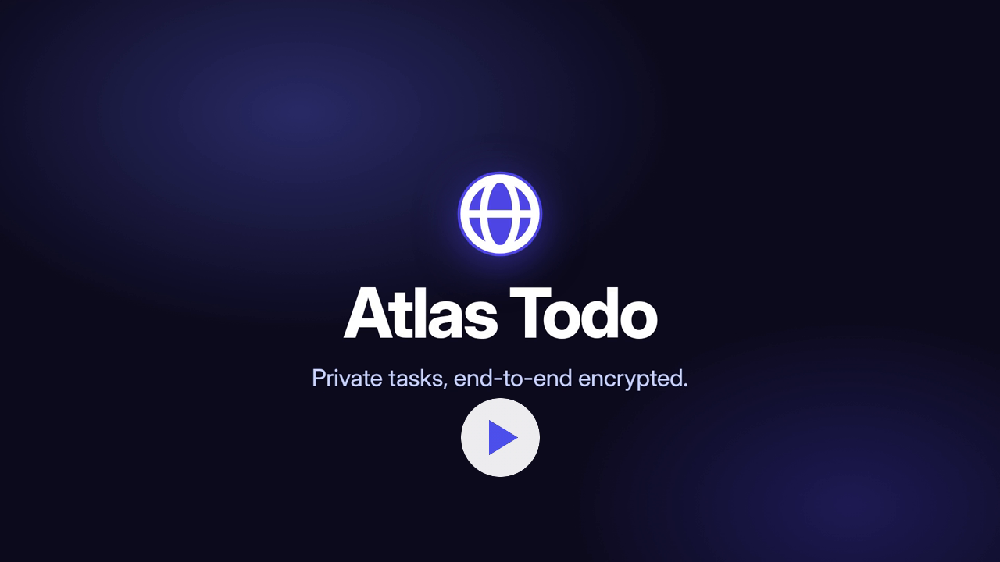</a>
</p>

<p>
  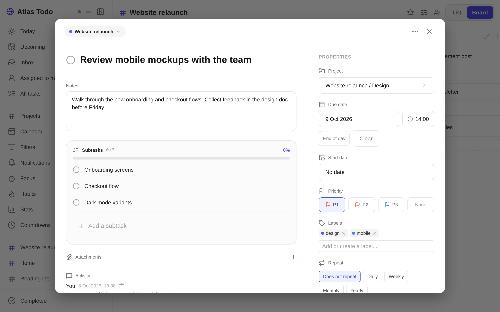
</p>

<p>
  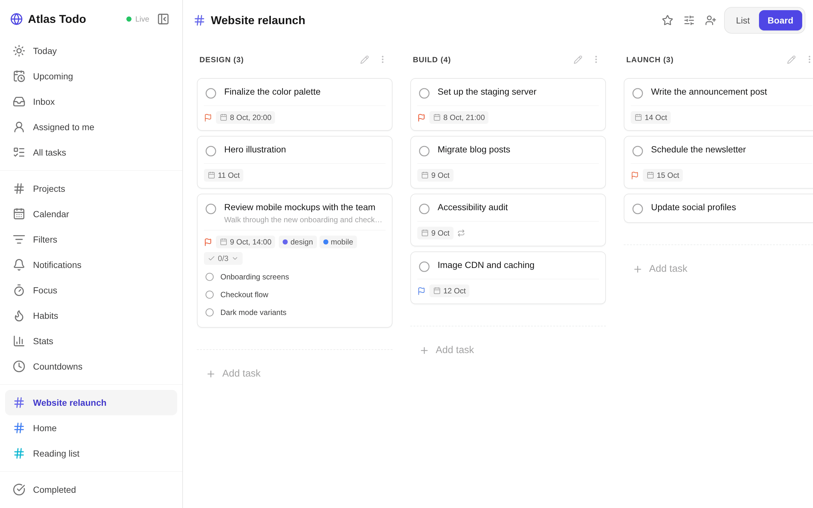
  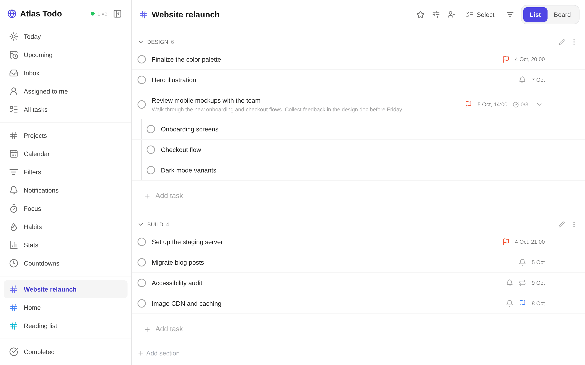
  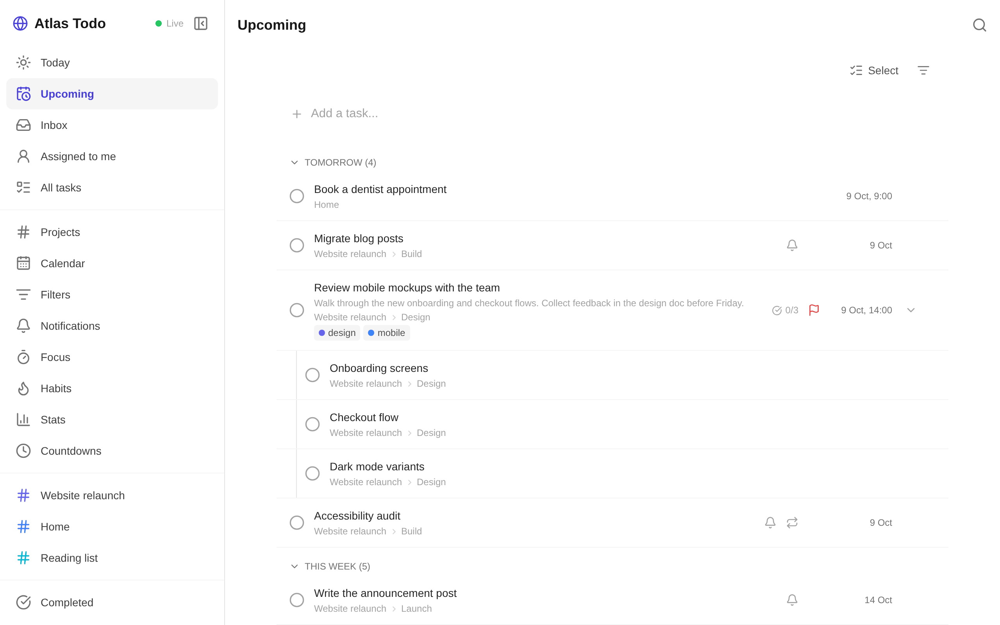
  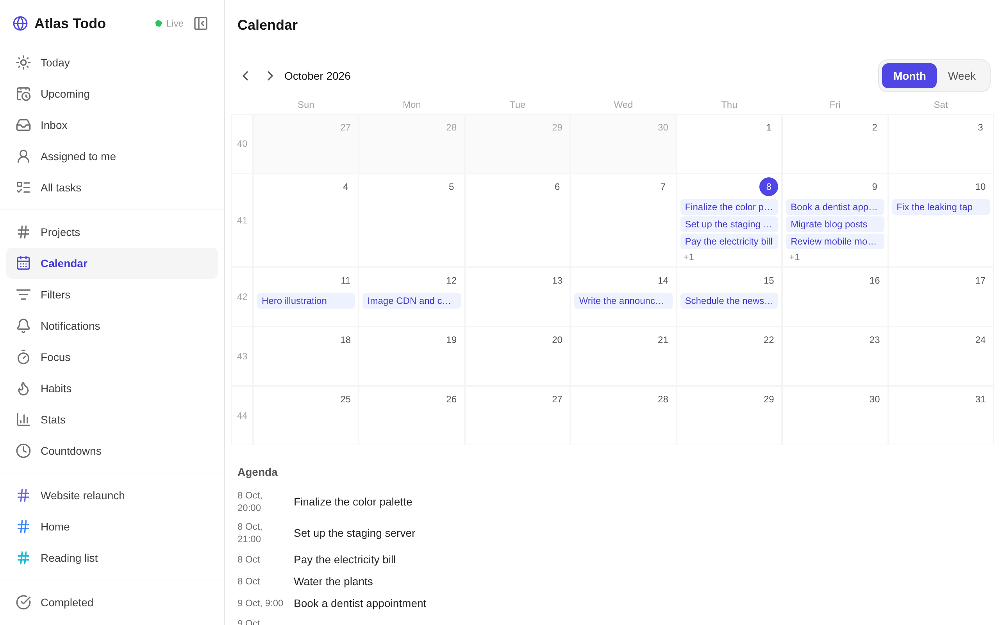
  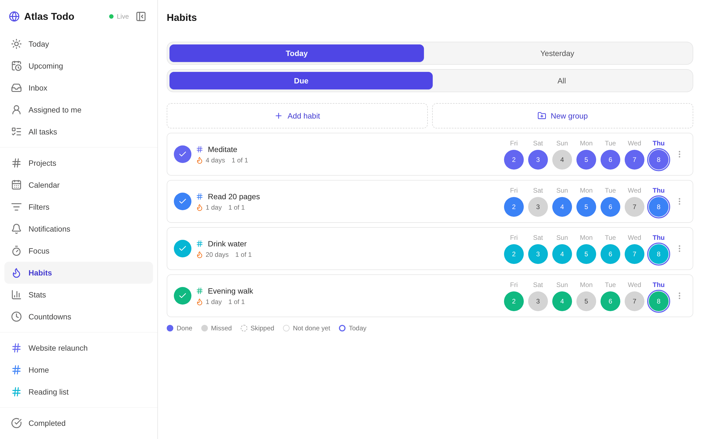
  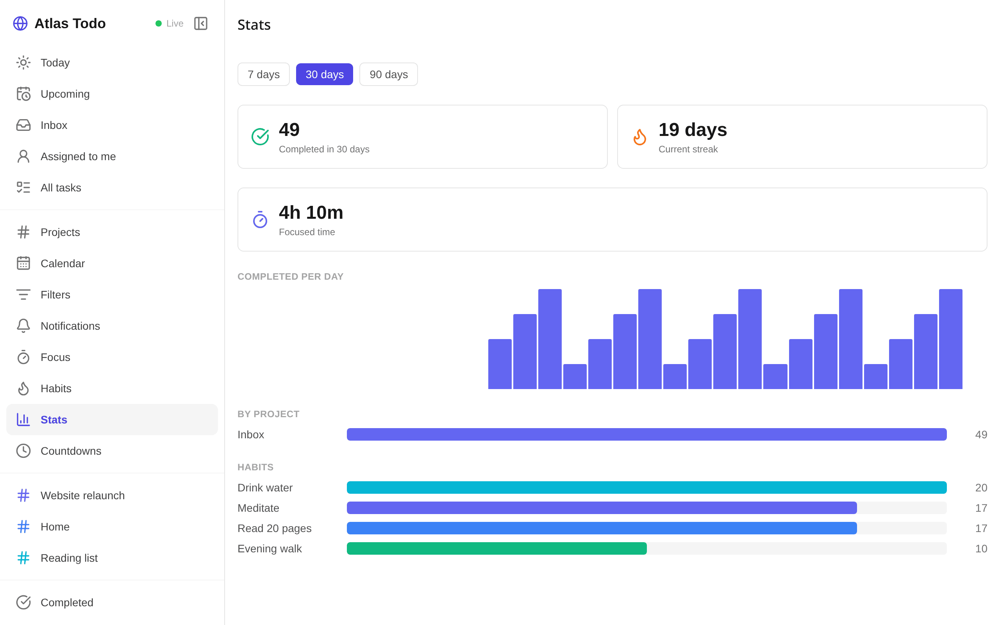
  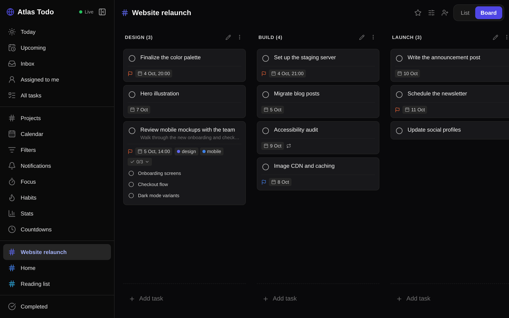
  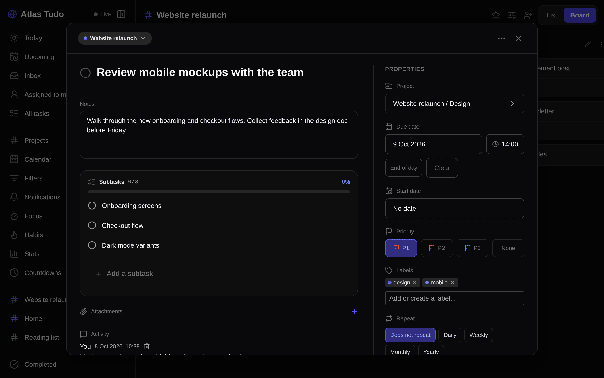
</p>

<p>
  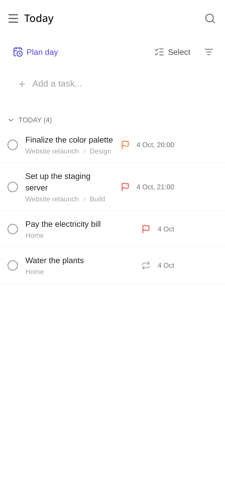
  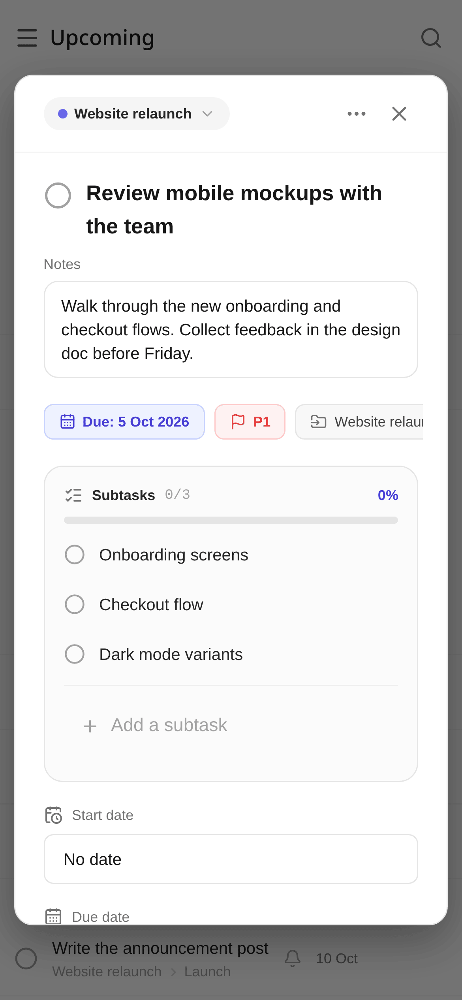
  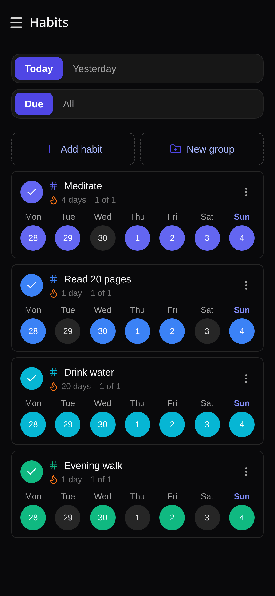
</p>

## Why Atlas Todo

Hosted to-do apps can read your tasks, and self-hosted ones usually can too: the server is where
the data is decrypted, if it is encrypted at all. Atlas Todo puts the keys on your devices
instead, and still gives you sharing, offline use and live sync across them.

|                                      | Atlas Todo | Todoist, TickTick | Vikunja |
| ------------------------------------ | :--------: | :---------------: | :-----: |
| Run it on your own server            |    yes     |        no         |   yes   |
| Server cannot read your tasks (E2EE) |    yes     |        no         |   no    |
| Shared projects                      |    yes     |        yes        |   yes   |
| Open source                          | yes (AGPL) |        no         |   yes   |

Not there yet:

- No iOS build is published, and the desktop app is Linux only (Electron).
- No CalDAV: the server cannot read tasks, so it cannot serve them to calendar apps.
- Two devices editing the same note offline keep the later edit whole, not a merge of both.

## Features

- End-to-end encryption: Task titles, notes, project names, labels, comments, habits and
  attachments are encrypted on your device. See [SECURITY.md](./SECURITY.md).
- Offline-first sync: Every change is saved locally first and synced as a log of
  field-level edits. Concurrent edits merge per field. Other devices update live over a
  WebSocket.
- Sharing: Invite people on the same server to a project as editors or commenters. Owners
  can promote members. Assign tasks, comment and see an activity feed.
- Tasks: Projects, sections, labels, subtasks, priorities, start and due dates, a trash and
  an archive.
- Recurrence: Repeat rules that step by calendar day in your time zone.
- Reminders: Local notifications on Android and desktop. In a browser they fire while the
  tab is open.
- Views: Inbox, Today, Upcoming, list, board (kanban), calendar, saved filters and
  countdowns.
- Quick add: Type "tomorrow 5pm" or "friday" and the date is set for you. Keyboard
  shortcuts and a command palette on web and desktop.
- Habits: Scheduled habits with check-ins and streaks.
- Focus: A pomodoro timer that logs focus time against tasks, plus productivity stats.
- Attachments: Files and images on tasks, encrypted before upload.
- Import and export: Import a TickTick CSV export, or a Todoist project CSV or full backup zip.
  Back up and restore your data as JSON.
- Passkeys: Sign in and unlock with a passkey on the web and Android, with or without a
  password, when the server enables them.
- Admin panel: Manage accounts, close signups, create signup invites, read bug reports and
  review the audit log.
- Languages: English, Danish, German, Spanish, French, Italian, Dutch, Polish and Brazilian
  Portuguese. Quick add understands dates, times and repeats typed in each of them.
- Platforms: Web (served by your server), Android, and a Linux desktop app (Electron).

## How it fits together

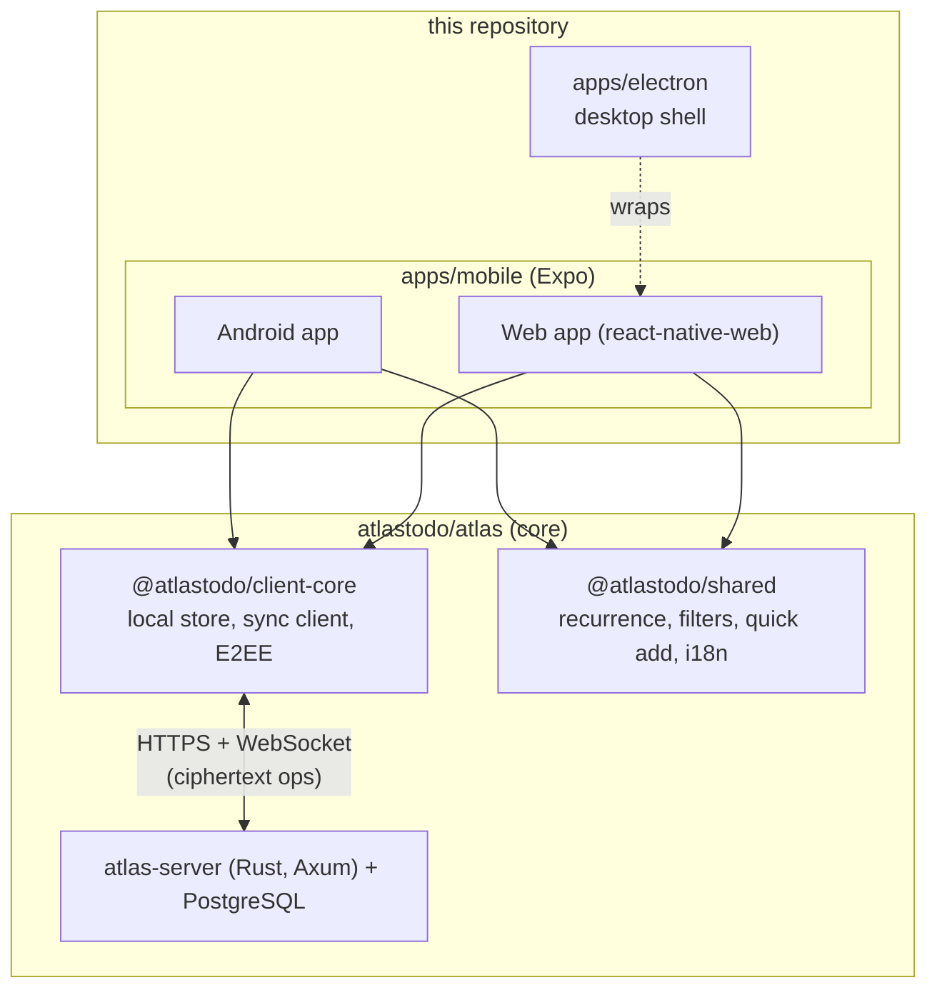

The app installs `@atlastodo/client-core` and `@atlastodo/shared` from a core release (pinned in
`apps/mobile/package.json`). The core repository's
[architecture notes](https://github.com/atlastodo/atlas/blob/main/docs/architecture.md) cover
sync, the clock and the key hierarchy, and its
[sync protocol](https://github.com/atlastodo/atlas/blob/main/docs/sync-protocol.md) the wire format.

## Self-hosting

The server is in the core repository: follow its
[README](https://github.com/atlastodo/atlas#readme) and
[self-hosting guide](https://github.com/atlastodo/atlas/blob/main/docs/self-hosting.md) (Docker
Compose, or the NixOS module). Its image serves this app's web build at the server's root URL,
so there is nothing to install here for the web app.

## Help test it on Android

Google Play only opens the app to the public after a closed test, so testers are welcome:

1. Join the [atlas-todo-testers](https://groups.google.com/g/atlas-todo-testers) Google Group with
   the Google account you use on your phone.
2. Opt in at [play.google.com/apps/testing/dev.sejder.atlastodo](https://play.google.com/apps/testing/dev.sejder.atlastodo)
   and install Atlas Todo from Google Play.
3. Report bugs in [Issues](https://github.com/atlastodo/atlas-todo/issues).

The test builds sign in to the test server at [app.atlastodo.dev](https://app.atlastodo.dev),
which may be reset; see the [privacy notice](https://atlastodo.dev/privacy.html).

## Getting the app

Release builds start out pointed at the test server, app.atlastodo.dev. To use your own instance,
change the _Server URL_ field on the sign-in screen.

- Web: your server serves the web app at its root URL. There is nothing to configure. Each
  release here also carries it as `atlas-todo-web-X.Y.Z.tar.gz`, the static files a server image
  or flake pins.
- Android: join the closed test on Google Play ([above](#help-test-it-on-android)), or download
  `atlas-todo-X.Y.Z.apk` from [GitHub Releases](https://github.com/atlastodo/atlas-todo/releases)
  and install it. [docs/android-permissions.md](./docs/android-permissions.md) lists the
  permissions it asks for, and why.
- Desktop (Linux): each release has `atlas-desktop-X.Y.Z.tar.gz`, which contains the app and a
  Nix flake for x86_64 and aarch64 Linux. See [apps/electron/README.md](./apps/electron/README.md)
  for the Nix setup; this repository's flake also has the `programs.atlas-desktop` NixOS and
  Home Manager modules.
- iOS: there is no published build. You can build one yourself with Expo EAS and an Apple
  Developer account; see [apps/mobile/RELEASE.md](./apps/mobile/RELEASE.md).
- Command line and automation: the `atlas` CLI is released from the core repository; see its
  [integrations guide](https://github.com/atlastodo/atlas/blob/main/docs/integrations.md).

## Getting help

- Questions and ideas: [Discussions](https://github.com/atlastodo/atlas-todo/discussions).
  Self-hosting help: the [core repository's Discussions](https://github.com/atlastodo/atlas/discussions).
- Bugs and concrete feature requests in the app: [Issues](https://github.com/atlastodo/atlas-todo/issues/new/choose);
  in the server: [core Issues](https://github.com/atlastodo/atlas/issues/new/choose).
- Vulnerabilities: privately, as [SECURITY.md](./SECURITY.md) describes, never in a public issue.
- Accessibility problems: [ACCESSIBILITY.md](./ACCESSIBILITY.md) has what is known and how to report.

Atlas Todo is a spare-time project with one maintainer. [SUPPORT.md](./.github/SUPPORT.md) says
what to expect, and the [roadmap](https://github.com/atlastodo/atlas/blob/main/ROADMAP.md) where
the project is heading.

## Development

The dev environment is [devenv](https://devenv.sh) (Nix). It provides Node 26, Bun and
Electron, and the Android SDK on request. The app talks to a server from the core repository
(run one there, or point the sign-in screen at any Atlas server).

```sh
devenv shell           # enter the environment
bun install
web:dev                # the web app with live reload, against EXPO_PUBLIC_API_URL
test:all               # the electron (vitest) and mobile (jest) suites
lint                   # typecheck, oxlint, Prettier, licences
```

[CONTRIBUTING.md](./CONTRIBUTING.md) covers the setup (including one without Nix), the test
runners, commit style and what CI checks.

## Privacy

There is no telemetry, analytics or crash reporting SDK: the apps talk to your server and nothing
else, with two exceptions. Release builds of the mobile app check Expo's update service
(`u.expo.dev`) for over-the-air updates when they start, and the Linux desktop app, unless it runs
from the Nix store, checks this repository's GitHub Releases API for a new version once a day
(`--no-update` or `ATLAS_DISABLE_UPDATE=1` turns that off).

## Repository layout

```
apps/mobile           React Native + Expo: the one UI, for Android, iOS and the web
apps/electron         Electron shell around the web export
docs/                 Android permissions allowlist, the README's screenshots
nix/                  Nix packages (web-dist, atlas-desktop), the desktop modules, the tarball's flake
scripts/              Release, packaging and licence tooling
site/                 The atlastodo.dev landing page, privacy notice and account deletion page
```

## License

Copyright (C) 2026 The Atlas Todo contributors.

Atlas Todo is licensed under the [GNU Affero General Public License v3.0 only](./LICENSE).
If you run a modified version as a network service, the AGPL requires you to offer its source
to your users.

Contributions are welcome; see [CONTRIBUTING.md](./CONTRIBUTING.md) and the
[Code of Conduct](./CODE_OF_CONDUCT.md).
